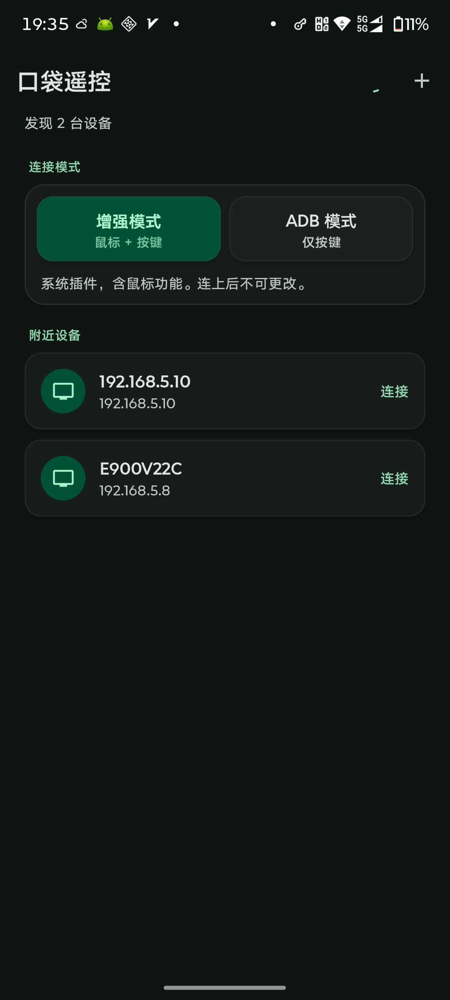
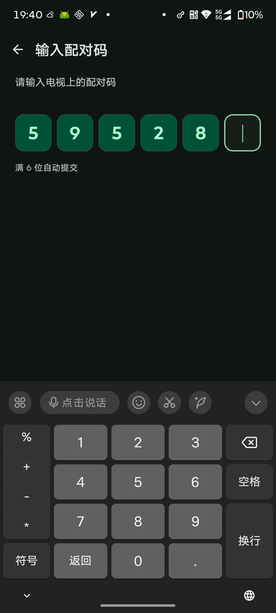
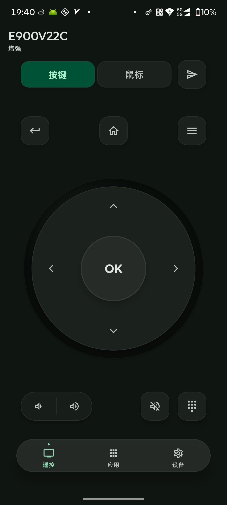
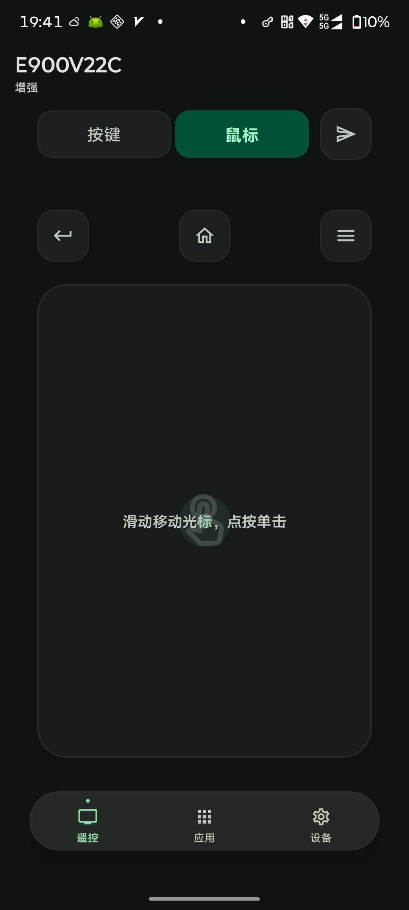
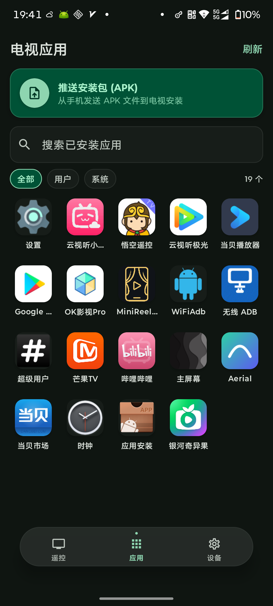
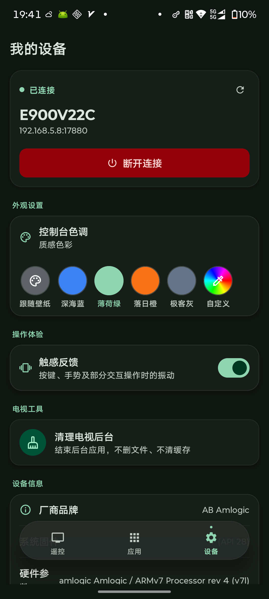

<p align="center">
  
</p>

<h1 align="center">口袋遥控</h1>

<p align="center">
  用 Android 手机遥控安卓电视或盒子。
</p>

<p align="center">
  <a href="LICENSE"></a>
  <a href="https://www.android.com"></a>
  <a href="https://developer.android.com/guide/topics/manifest/uses-sdk-element#ApiLevels"></a>
  <a href="https://github.com/rianlu/pocket-remote-android"></a>
  <a href="https://kotlinlang.org"></a>
</p>

<p align="center">
  电视端请安装 <a href="https://github.com/rianlu/pocket-remote-helper-android"><b>口袋遥控助手</b></a>
</p>

手机和电视在同一 Wi-Fi。助手显示 6 位配对码，手机输入后发送方向键、文字、鼠标和应用操作。按键由电视端注入，手机不在本机模拟。

## 预览

| 发现设备 | 配对 | 按键 |
| :---: | :---: | :---: |
|  |  |  |

| 鼠标 | 应用 | 我的设备 |
| :---: | :---: | :---: |
|  |  |  |

## 功能

- 局域网发现设备。NSD 失败则改用 UDP，仍失败可以手动填写 IP。
- 连接前选择模式，连上后本次会话不可更改。
  - **增强模式**：电视已安装系统插件，可以使用鼠标和按键。
  - **ADB 模式**：电视已打开网络调试，只能发送按键。
- 6 位配对码，满位自动提交，配对结果会保留。
- **遥控**：返回、主页、菜单、方向键、确认、音量、静音和数字键盘。纸飞机把文字发到电视当前焦点。增强模式下可切换触控板。
- **应用**：搜索、打开、卸载用户应用，并把手机里的 APK 发到电视安装。
- **设备**：查看地址、断开连接、控制台配色、按键振动，以及清理电视后台。清理只结束后台应用。

底栏三个页面共用一条 WebSocket。

## 不做

投屏、电源键、完整文件管理器、输入法、无障碍。ADB 只作为注入通道，不是遥控协议本身。

## 开始使用

- Android 8.0 及以上手机
- 与电视在同一局域网
- 电视上已打开「口袋遥控助手」

## 构建

```bash
export ANDROID_HOME=/path/to/Android/sdk
./gradlew assembleDebug
```

安装包：`app/build/outputs/apk/debug/app-debug.apk`

模拟器里的电视请用 `adb forward`，不要填写电脑上看不到的模拟器地址。

## 项目信息

| | |
|---|---|
| applicationId | `com.pocketremote` |
| 版本 | 0.2.9 |
| minSdk / targetSdk | 26 / 35 |
| UI | Jetpack Compose · Material 3 |

| 文档 | 内容 |
|---|---|
| [`docs/PROTOCOL.md`](docs/PROTOCOL.md) | 协议文本，须与助手仓库逐字一致 |
| [`docs/SPEC.md`](docs/SPEC.md) | 本端实现 |
| [`docs/ARCHITECTURE.md`](docs/ARCHITECTURE.md) | 形态与范围 |
| [`AGENTS.md`](AGENTS.md) | 贡献约定 |

## 许可证

[Apache License 2.0](LICENSE)
